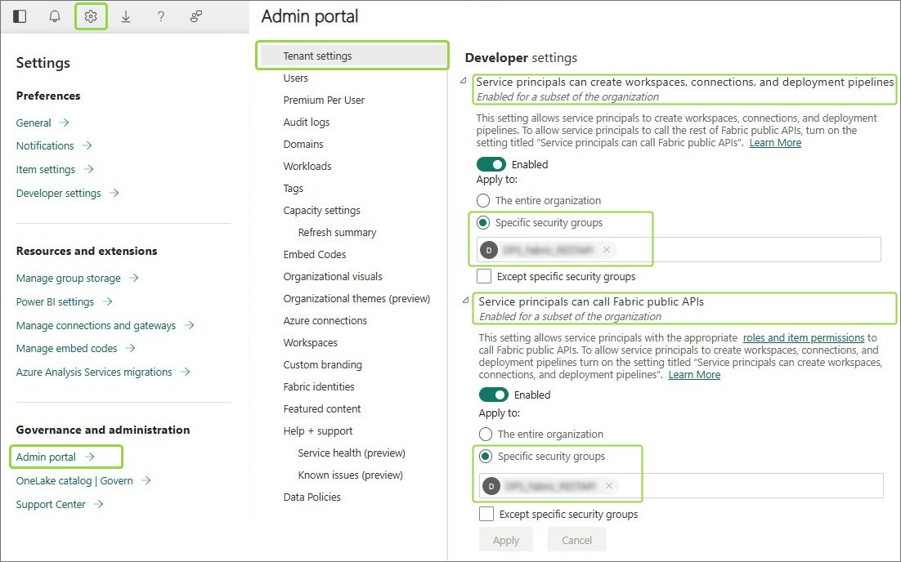
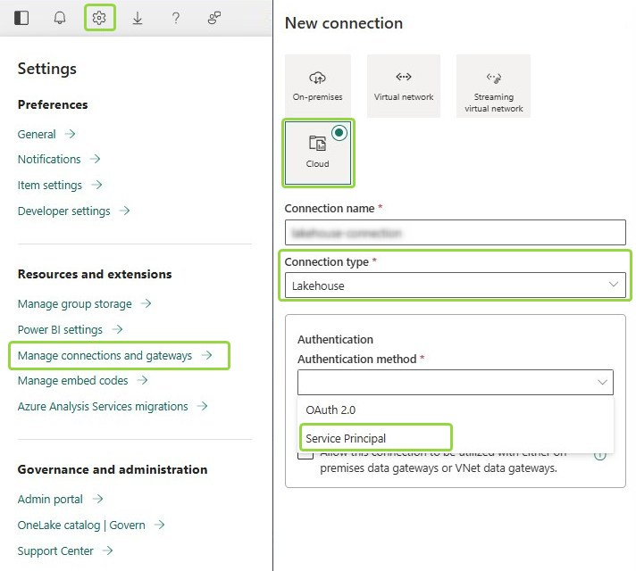

# 01.02 Shared tasks

This document will guide you to execute tasks that are common between all the environments

## 1. Prepare Fabric Admin Portal

It is necessary to update couple of settings in the Fabric/PowerBI `Admin Portal`

It is necessary to enable `Service principal can create workspaces, connections, and deployment pipelines` and `Service principals can call Fabric public APIs`.

> It is high recommended to restrict this access to specific entities. You can use the Security group set in [Security group name](01-01-Tenant-naming-rule.md#security-group).

## 2. Create connections in Fabric

### 2.a Create connection to Fabric SQL databases

For pipelines, it is necessary to create a Fabric Connection to Fabric SQL databases

On the settings of Fabric, go to `Manage connections and gateways` and create a new Cloud `SQL database in fabric` connection.

> This connection allow a pipeline connect to a Fabric SQL, but it will anyway to set to which Workspace / SQL database and it needs to have already access to this SQL Database

### 2.b Create connection to Fabric Lakehouse

For pipelines, it is necessary to create a Fabric Connection to Fabric Lakehouse connections

On the settings of Fabric, go to `Manage connections and gateways` and create a new Cloud `Lakehouse` connection.

> This connection allow a pipeline connect to a Fabric Lakehouse, but it will anyway to set to which Workspace / Lakehouse and it needs to have already access to this Lakehouse

