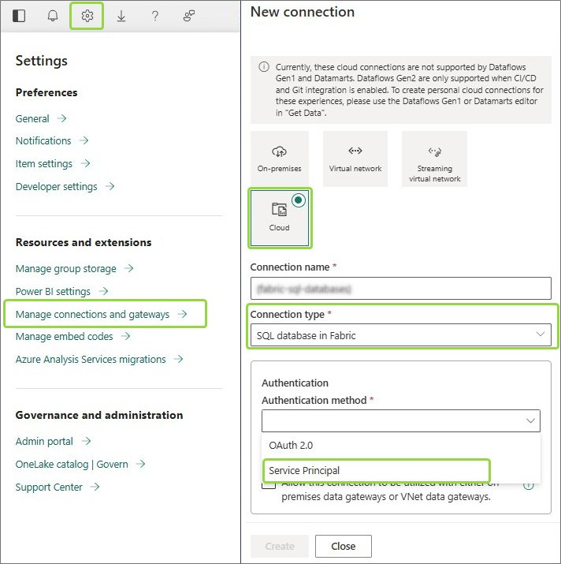

# 01.02 Shared tasks

This document guides you through executing tasks that are common across all environments.

## 1. Prepare Fabric Admin Portal

You must update several settings in the Fabric/PowerBI `Admin Portal`.

You must enable the following settings:
- `Service principal can create workspaces, connections, and deployment pipelines`
- `Service principals can call Fabric public APIs`

> It is highly recommended to restrict this access to specific entities. You can use the Security group defined in [Security group name](01-01-Tenant-naming-rule.md#security-group) adding in the `Specific security groups`.

## 2. Create connections in Fabric

### 2.a Create connection to Fabric SQL databases

Pipelines require a Fabric Connection to Fabric SQL databases. In the Fabric settings, navigate to `Manage connections and gateways` and create a new Cloud `SQL database in fabric` connection.

> This connection enables pipelines to connect to a Fabric SQL Database. You must specify the target Workspace and SQL Database, and ensure the pipeline has the necessary access permissions.

### 2.b Create connection to Fabric Lakehouse

Pipelines also require a Fabric Connection to Fabric Lakehouse. In the Fabric settings, navigate to `Manage connections and gateways` and create a new Cloud `Lakehouse` connection.

> This connection enables pipelines to connect to a Fabric Lakehouse. You must specify the target Workspace and Lakehouse, and ensure the pipeline has the necessary access permissions.

