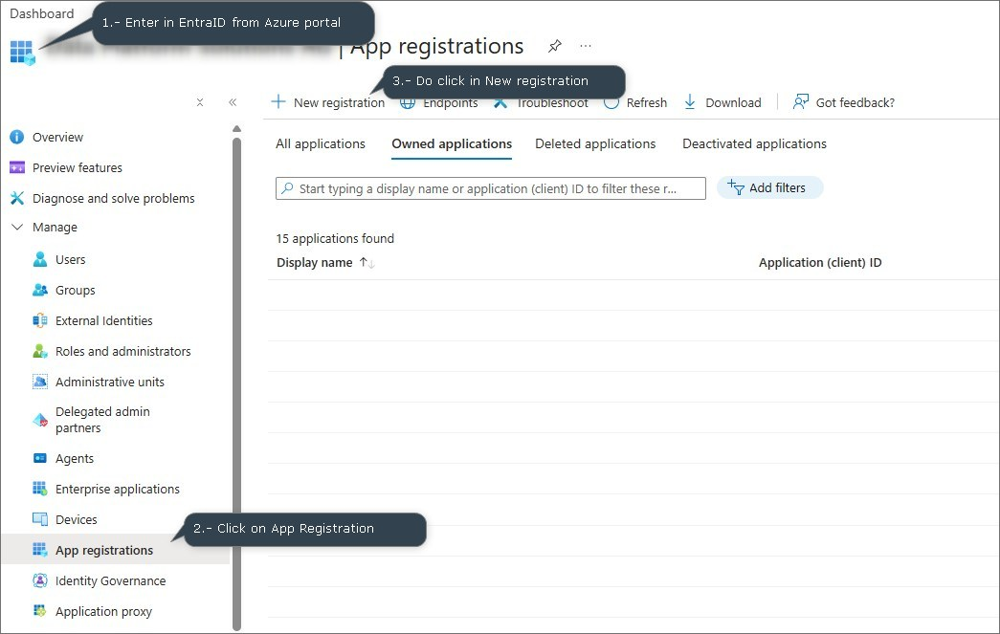
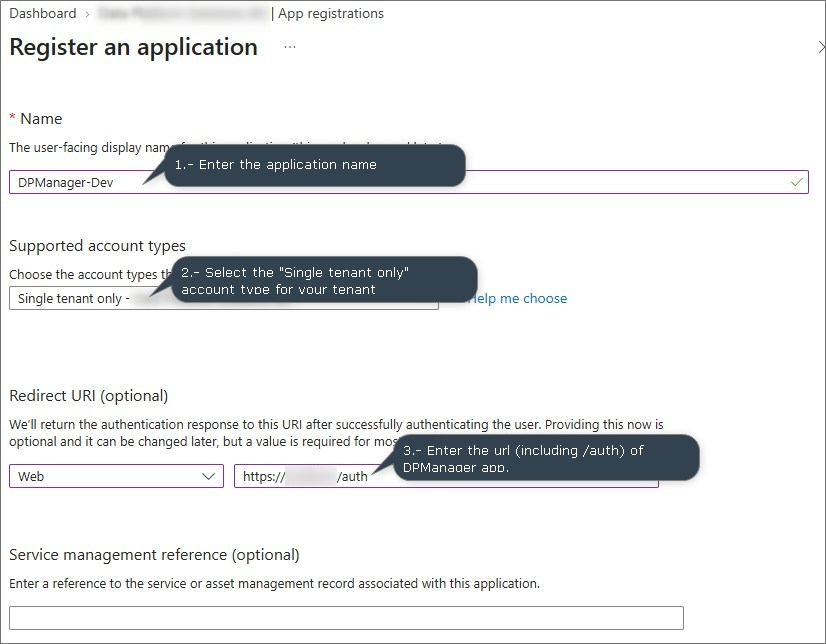
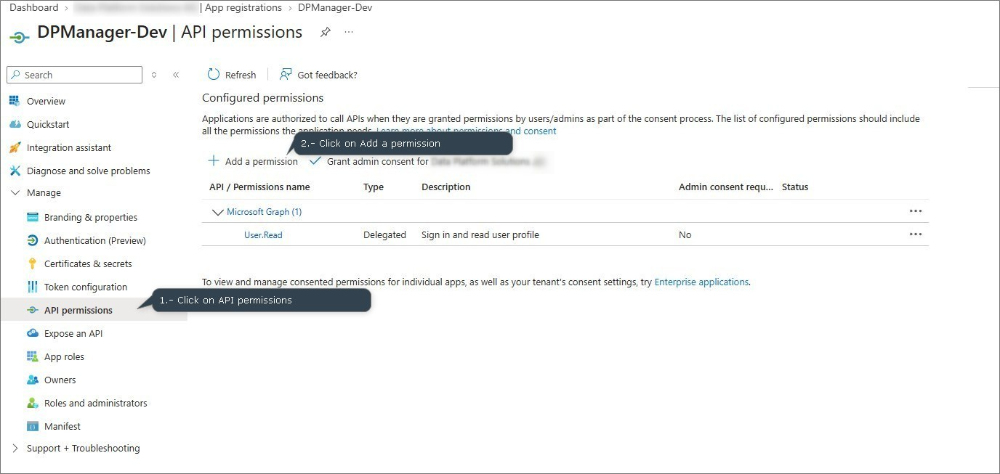
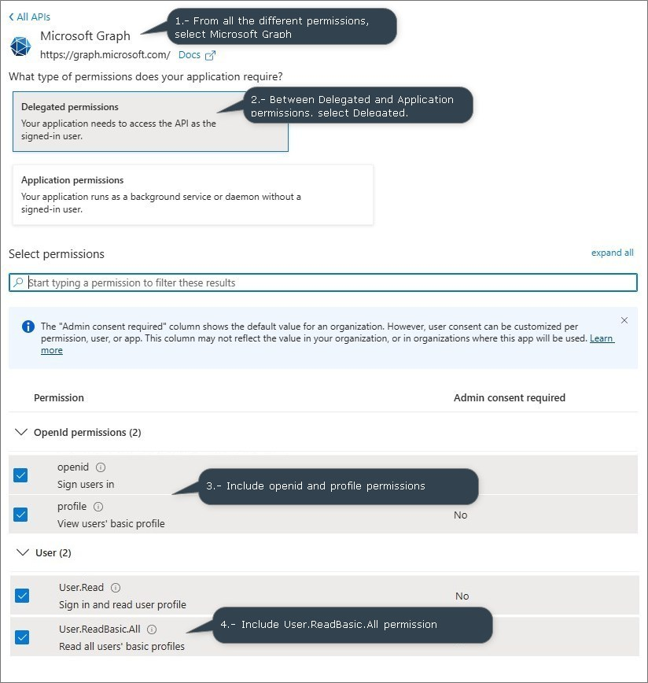
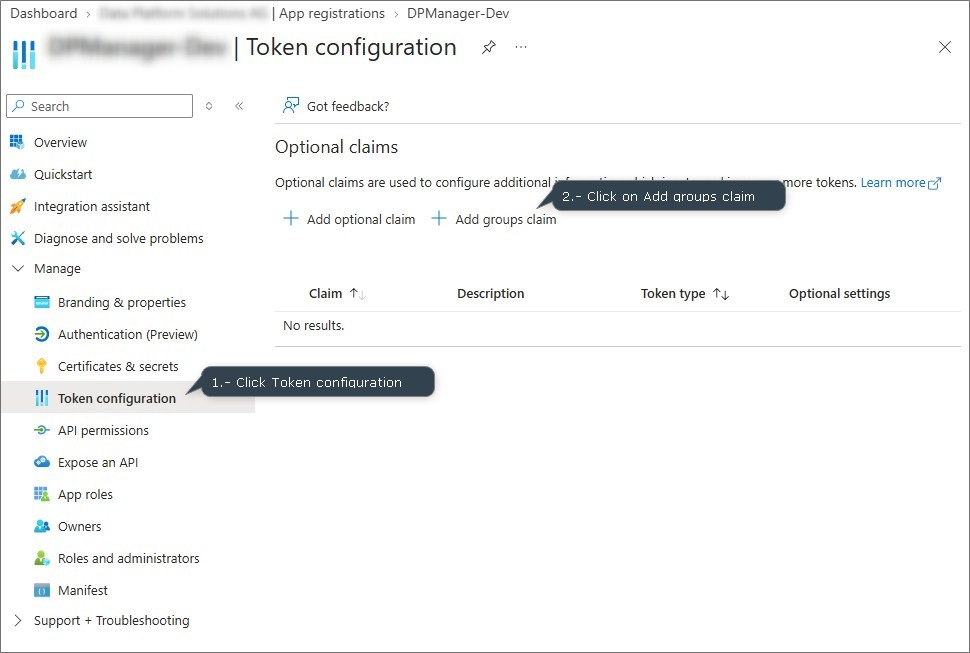
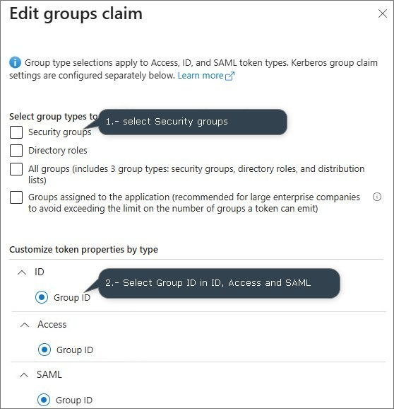
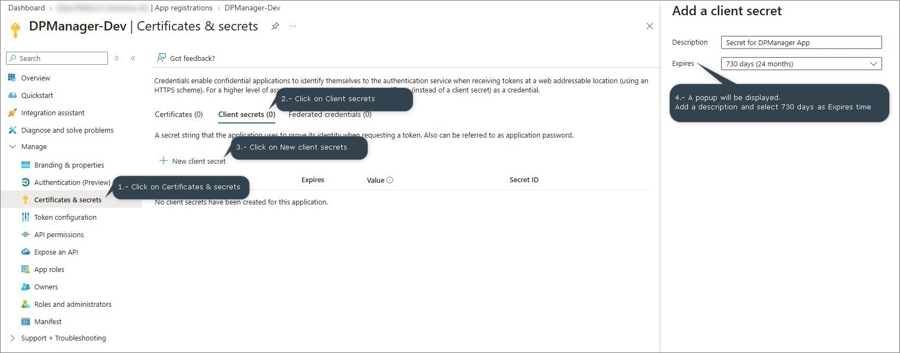
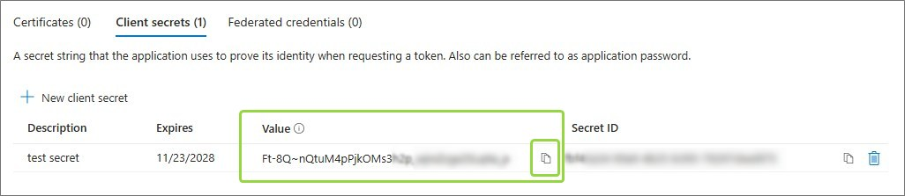
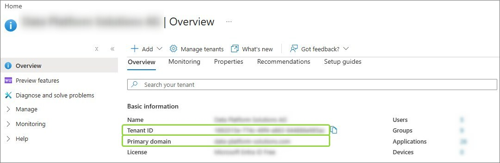
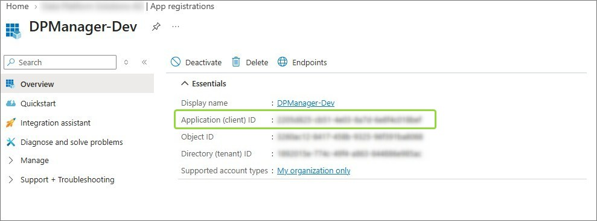

# 02.02 Microsoft Entra ID: Register Data Platform Manager application

For the DPManager .NET web application, you must register an application in Microsoft Entra ID (formerly Azure Active Directory). This registration establishes trust and allows Entra ID to authenticate and authorize users and applications securely.

## A. Register a new application

- Open `Microsoft Entra ID` and, in the left-hand menu, select `App registrations`, then select `New registration`.  

- Complete the registration form:

> Remember the name of the DPManager app has been set here: [Service principal names](../02-Environment-Tasks/02-01-Environemnt-names.md#service-principal-names)

> To complete the registration, you would need to know the Redirect URI. This information can be delivered by Data Platform Solutions AG member.  
> It is necessary to have prepared:
> - Name of the customer
> - Instance abbreviation
> 
> The URI should have have this format: `https://{instance_dpmanager_app_domain}/auth`

## B. Configure API permissions

- After the app is registered, configure the Microsoft Graph API permissions required by the application.  
  Go to `API permissions` and select `Microsoft Graph`.

- Select the follow permissions, in Microsoft Graph:
  - `openid`
  - `profile`
  - `User.Read`
  - `User.ReadBasic.All`

## C. Configure the token

Configure the groups claim that the application receives in the token after user authentication.

- Go to `Token configuration` and select `Add groups claim`.  

- In the new window, select `Security groups` under **Group types**, and configure the group claims as follows:
  - **ID:** `Group ID`
  - **Access:** `Group ID`
  - **SAML:** `Group ID`

## D. Generate an application secret

Generate a client secret to allow DPManager to identify itself as the registered application.

> **Important:** The client secret value is only displayed once immediately after creation. If you navigate away, close the page, or exit your browser, you won't be able to retrieve it—you'll need to create a new secret instead. Save the value securely before proceeding.

## E. Collect the required information

- **Tenant ID and domain:** You can find these on the Microsoft Entra ID overview page.

- **Client ID:** You can find this on the overview page of the application you created in the previous steps.

- **Client secret:** This was generated in step D. Remember that the secret value is only visible once.
