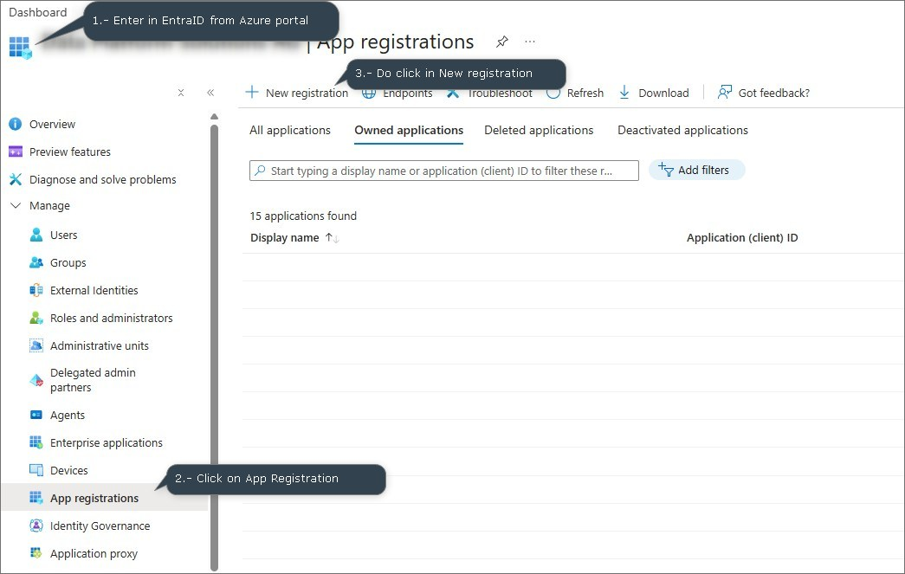
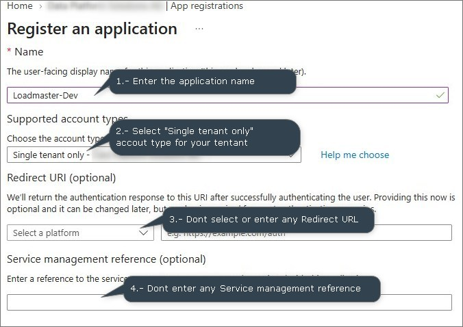
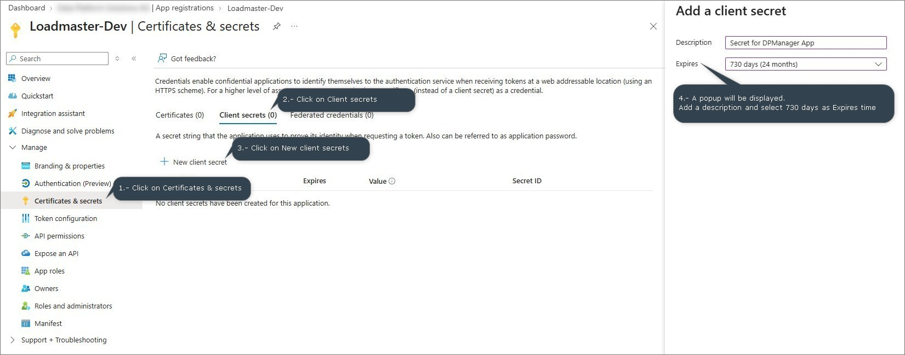
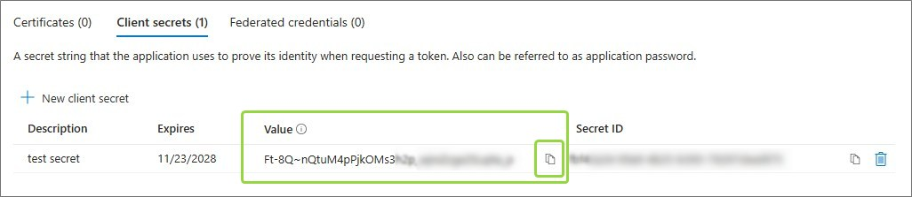
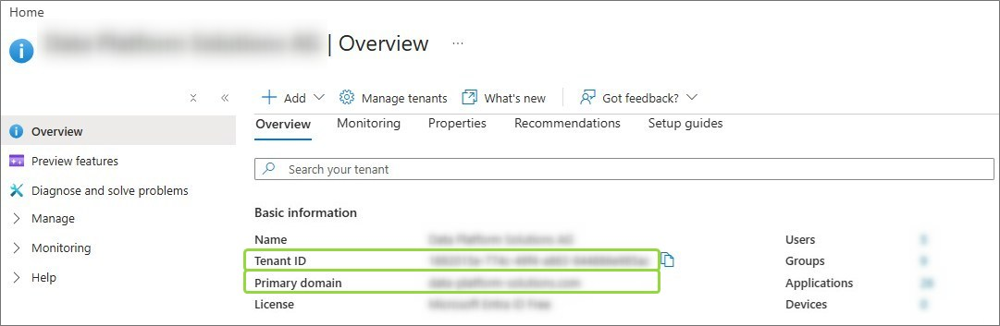
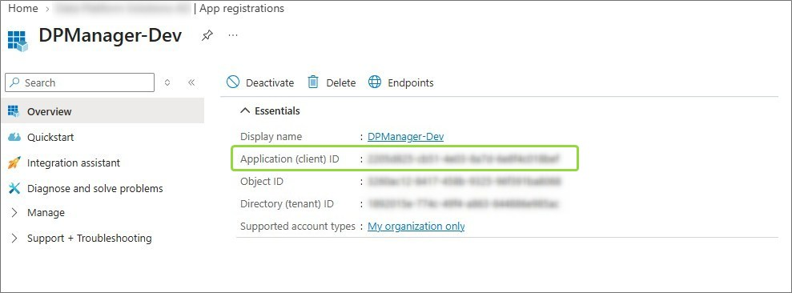

# 02.03 Microsoft Entra ID: Register Loadmaster application

For the Loadmaster orchestrator, you must register an application in Microsoft Entra ID (formerly Azure Active Directory). This registration establishes trust and allows the orchestrator to interact with Microsoft Fabric objects

## A. Register a new application

- Open `Microsoft Entra ID` and select `App registrations` from the left-hand menu, then select `New registration`.

- Complete the registration form with the application details:

> Remember the name of the DPManager app has been set here: [Service principal names](../02-Environment-Tasks/02-01-Environemnt-names.md#service-principal-names)

## B. Generate an application secret

Generate a client secret to allow Loadmaster to identify itself as the registered application.

> **Important:** The client secret value is only displayed once immediately after creation. If you navigate away, close the page, or exit your browser, you won't be able to retrieve it—you'll need to create a new secret instead. Save the value securely before proceeding.

## E. Collect the required information

- **Tenant ID and domain:** You can find these on the Microsoft Entra ID overview page.

- **Client ID:** You can find this on the overview page of the application you created in the previous steps.

- **Client secret:** This was generated in step B. Remember that the secret value is only visible once.
