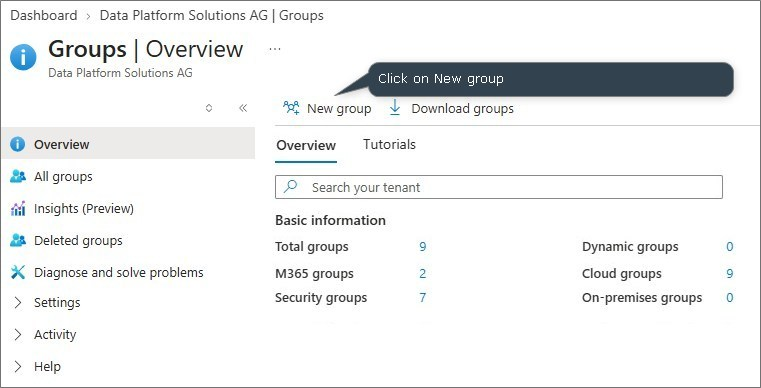

# 02.04 Microsoft Entra ID Groups

To create all the groups defined in [Security group names](02-01-Environemnt-names.md#dpmanager-and-roles-and-entraid-security-groups), access `Entra ID` in Azure and navigate to `Groups`.

Click on `New group`.

Enter the name for the new Security Group and assign an owner.

