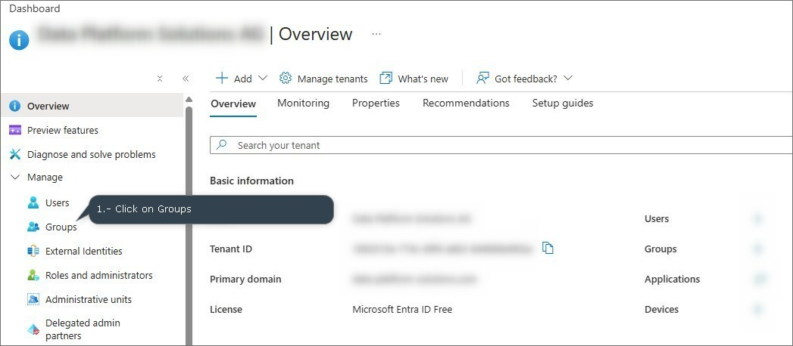
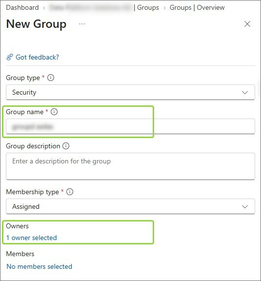

# 02.04 Microsoft Entra ID Groups

To create all the groups that have been set here: [Security group names](02-01-Environemnt-names.md#dpmanager-and-roles-and-entraid-security-groups) it is necessary access to `Entra ID` in Azure.  
From `Entra ID` access to `Groups`

Do click in `New group`

Fill the name for the new Security Group and set an owner.

