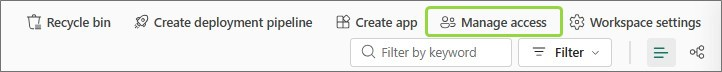
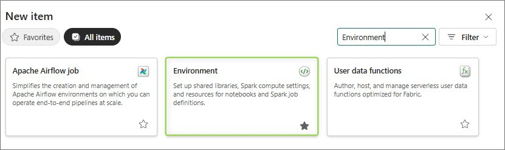
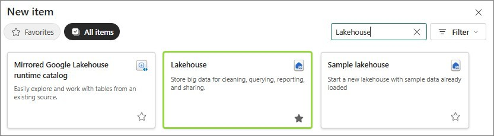
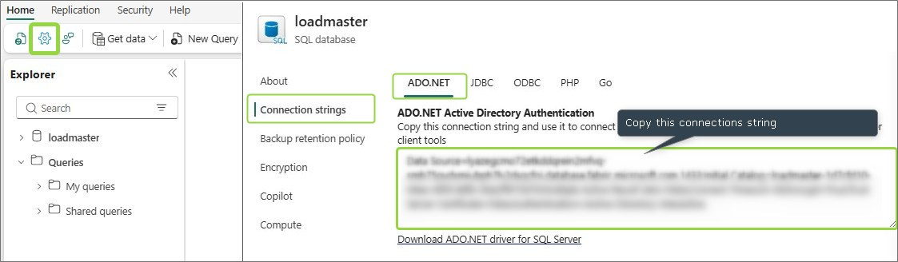

# 02-05 Microsoft Fabric preparation


This document will try to guide you to prepare Microsoft Fabric for a environment 

## 1. Create workspace

It is necessary to create the workspace where all the objects will be deployed.  
It is important to select the proper Fabric Capacity. Confirm this capacity is the same Azure Zone defined here: [Customer naming convention](01-Tenant-naming-rule.md#customer-naming-convetion)  

The name of the workspace has been set here: [Fabric object names](02-Environemnt-names.md#fabric-object-names)

> Dont forget to get and keep the GUID of this workspace

### 1.a Set capacity

Set the Fabric Capacity in the workspace


### 1.b Add access

Add as `Contributor` the service principal of Loadmaster. Remember the name of the Loadmaster service principal has been set in [Service principal names](02-Environemnt-names.md#service-principal-names)  
Also, add the consultant users as `Contributor` as well.



## 2. Create environment

It is necessary to create enviornment in the workspace.  
It is not necessary to apply any change inside of this environment. DPManager will apply all the necessary changes.



> Dont forget to get and keep the GUID of this environment

## 3. Create Lakehouse

The next step would be create the lakehouse



> Dont forget to get and keep the GUID of this lakehouse

## 4. Create Databases

Now, it is necessary to create the different databases.


### 4.a Create databases

The SQL database that need to be created are:

- dpmu : use the name set here [Fabric object names](02-Environemnt-names.md#fabric-object-names)
- biman : use the name set here [Fabric object names](02-Environemnt-names.md#fabric-object-names)
- loadmaster : use the name set here [Fabric object names](02-Environemnt-names.md#fabric-object-names)

### 4.b Add Service principal as Owner

After the creation it is necessary to add the loadmaster service principal in the 'owner' role in the database.

```sql
CREATE USER [{app-loadmaster-name}] FROM EXTERNAL PROVIDER;
GO
ALTER ROLE db_owner  ADD MEMBER [{app-loadmaster-name}];
GO
```

### 4.c Get connection string

After the creation it is necessary to get the connection string for the deployment process.  
This a information requested in by Data Platform Solutions.

To get the connection string, it necessary, in Fabric, to enter in the database and access to the settings.

In the setting, select `Connection strings`. Be sure that `ADO.NET` is selected.




## Final tasks list:

- [ ] Create workspace
- [ ] Set workspace fabric capacity
- [ ] Set workspace members
- [ ] Create Environemnt
- [ ] Create Lakehouse
- [ ] Create SQL Database dpmu
- [ ] Add Service Principal as `owner` of dpmu
- [ ] Get ADO.NET connection string of dpmu
- [ ] Create SQL Database loadmaster
- [ ] Add Service Principal as `owner` of loadmaster
- [ ] Get ADO.NET connection string of loadmaster
- [ ] Create SQL Database biman
- [ ] Add Service Principal as `owner` of biman
- [ ] Get ADO.NET connection string of biman
