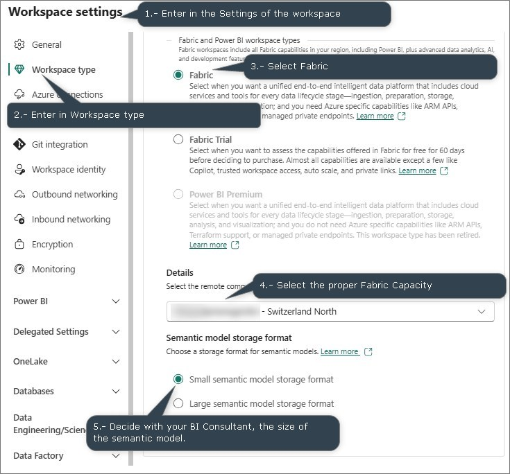
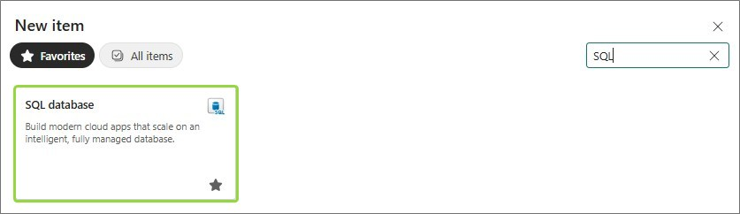

# 02-05 Microsoft Fabric preparation


This document guides you through preparing Microsoft Fabric for a new environment.

## 1. Create workspace

Create the workspace where all objects will be deployed. Select the appropriate Fabric Capacity that matches the Azure Zone defined in [Customer naming convention](01-Tenant-naming-rule.md#customer-naming-convention).

The workspace name has been defined in [Fabric object names](02-Environemnt-names.md#fabric-object-names).

> Save and store the GUID of this workspace.

### 1.a Set capacity

Configure the Fabric Capacity for the workspace.



### 1.b Add access

Add the Loadmaster service principal with the `Contributor` role. The Loadmaster service principal name is defined in [Service principal names](02-Environemnt-names.md#service-principal-names).

Also add your consultant users as `Contributor`.


## 2. Create environment

Create an environment in the workspace. No configuration changes are needed at this stage—DPManager will apply all required settings.


> Save and store the GUID of this environment.

## 3. Create Lakehouse

Create the lakehouse in the workspace.


> Save and store the GUID of this lakehouse.

## 4. Create Databases

Create the required SQL databases in the workspace.



### 4.a Create databases

The following SQL databases must be created using the names defined in [Fabric object names](02-Environemnt-names.md#fabric-object-names):

- dpmu
- biman
- loadmaster

### 4.b Add Service principal as Owner

After database creation, add the Loadmaster service principal with the 'owner' role using the following SQL commands:

```sql
CREATE USER [{app-loadmaster-name}] FROM EXTERNAL PROVIDER;
GO
ALTER ROLE db_owner  ADD MEMBER [{app-loadmaster-name}];
GO
```

### 4.c Get connection string

After database creation, obtain the connection string needed for the deployment process. In Fabric, enter each database and navigate to settings.

In the settings, select `Connection strings` and ensure `ADO.NET` is selected.


## Final tasks list:

- [ ] Create workspace
- [ ] Set workspace fabric capacity
- [ ] Set workspace members
- [ ] Create Environemnt
- [ ] Create Lakehouse
- [ ] Create SQL Database dpmu
- [ ] Add Service Principal as `owner` of dpmu
- [ ] Get ADO.NET connection string of dpmu
- [ ] Create SQL Database loadmaster
- [ ] Add Service Principal as `owner` of loadmaster
- [ ] Get ADO.NET connection string of loadmaster
- [ ] Create SQL Database biman
- [ ] Add Service Principal as `owner` of biman
- [ ] Get ADO.NET connection string of biman
