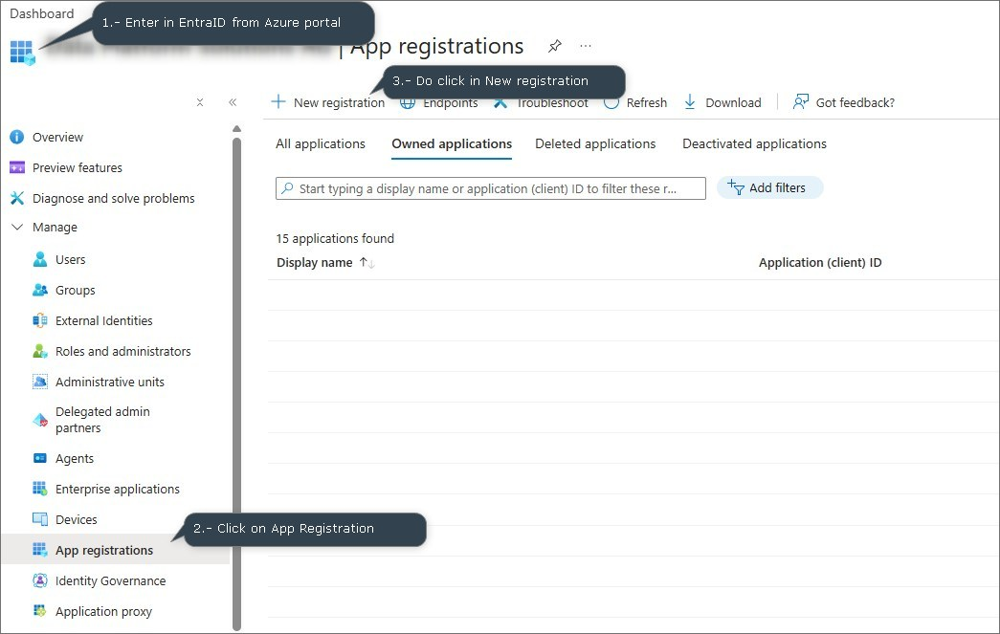
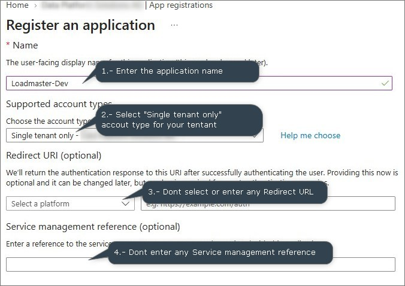
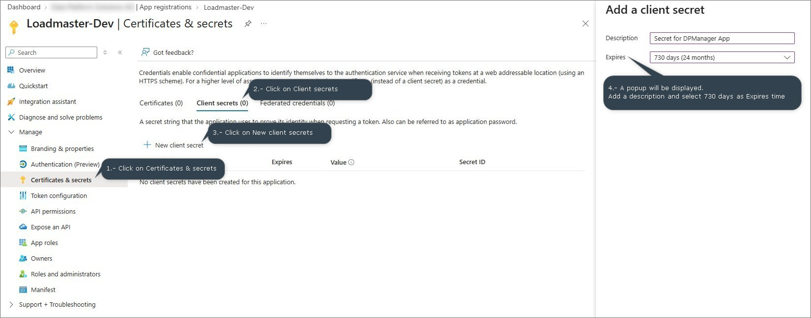
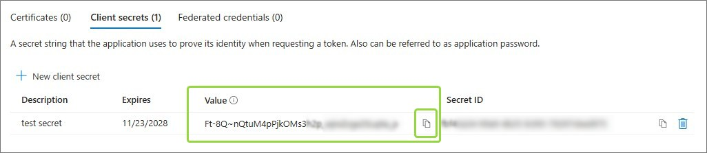
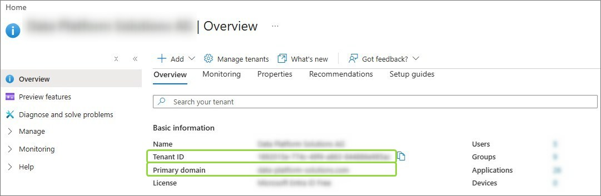
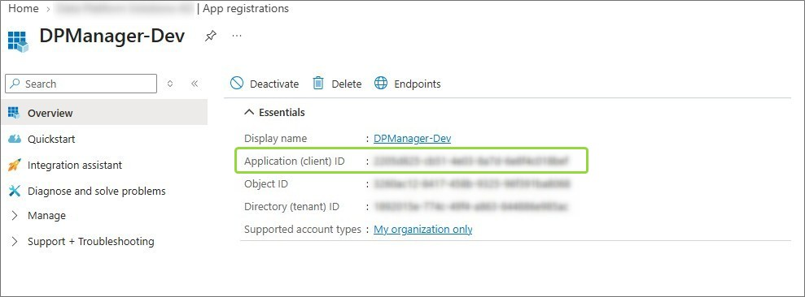

# Microsoft Entra ID: Register Loadmaster application

For the Loadmaster orchestrator, you must register an application in Microsoft Entra ID (formerly Azure Active Directory). This registration establishes trust and allows the orchestrator to interact with Microsoft Fabric objects

## A. Register a new application

- Open `Microsoft Entra ID` and, in the left-hand menu, select `App registrations`, then select `New registration`.  

- Complete the registration form:

You can find the name for DPManager and the URL ( or URLS ) you need to set on [Link Text](path/to/other-file.md#section-heading) TODO: update link

## B. Generate an application secret

Generate a client secret so that DPManager can identify itself as the registered application.  

> **Important:** The client secret value is only displayed once immediately after creation. If you navigate away, close the page, or exit your browser, you won't be able to retrieve it—you'll need to create a new secret instead. Save the value securely before proceeding.

## E. Collect the required information

- **Tenant ID and domain:** You can find these on the Microsoft Entra ID overview page.  

- **Client ID:** You can find this on the overview page for the application you created in the previous steps.  

- **Client secret:** This was generated in step b. Remember that you can view the secret value only once.
